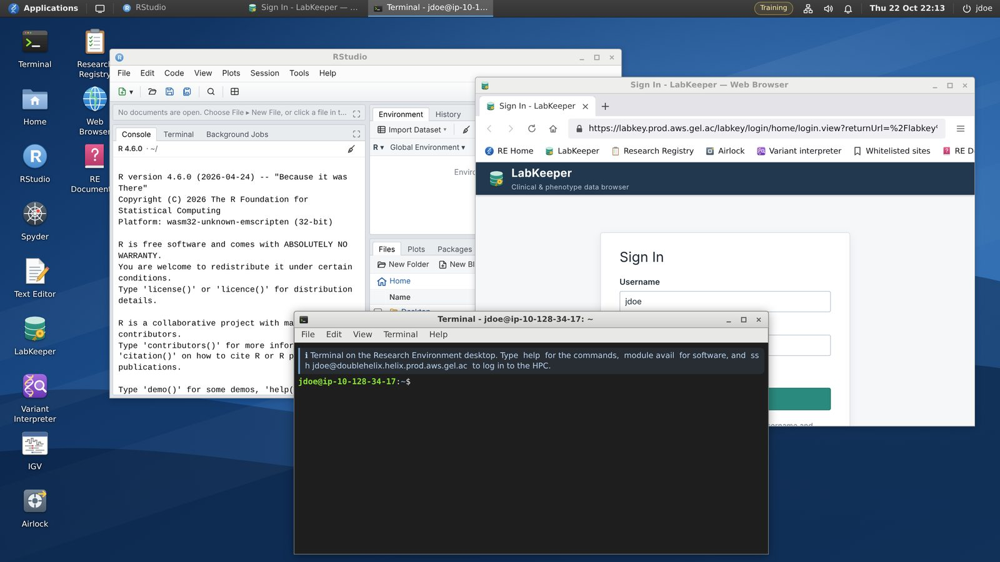

# Research Environment simulator: user guide

This is the user guide for the **Research Environment simulator**, the training copy of the Genomics England Research Environment (RE) that you use on the GM2 Research and Statistical Skills course. In it you practise working in a trusted research environment, and the statistics you learn each week, on synthetic data.

**Open the simulator:** <https://comparativechrono.github.io/GEL-environment/>

The simulator runs entirely in your web browser. The clinical data are synthetic and the genomes are public cell-line data, so nothing in it describes a real person, and nothing you do reaches Genomics England. It was built for teaching and is not made or endorsed by Genomics England.

## Weekly tasks

Each week we add tasks here that use what you have just been taught.

| Week | Topic | Task |
| --- | --- | --- |
| 1 | Pre-registration | [Register a project and export your proposal through the Airlock](tasks/week-01-pre-registration.md) |
| 2 | Describing data, distributions and uncertainty | [Describe the cohort, look at distributions, and put confidence intervals on estimates](tasks/week-02-describing-data.md) |
| 3 | Testing hypotheses and comparing groups | [Compare groups, test tables of counts, and check genotypes for Hardy–Weinberg equilibrium](tasks/week-03-testing-hypotheses.md) |
| 4 | Regression | [Fit linear and logistic regressions, with genotypes as predictors, confounders and interactions](tasks/week-04-regression.md) |
| 5 | Genome-scale inference | [Run a genome-wide association study, from quality control to multiple testing and linkage disequilibrium](tasks/week-05-genome-scale-inference.md) |

All the tasks are listed in [tasks](tasks/README.md).

## Quick start

1. Open the simulator on a laptop or desktop computer, in a current version of Chrome, Edge, Firefox or Safari.
2. Sign in with your first initial and surname, for example `jdoe`. Any password and any six-digit verification code are accepted. Use the same username every time: your files belong to it.
3. The icons on the left of the desktop open the applications. The **RE Documentation** icon opens a start page with a route through them.
4. Work as you would in the real RE: register a project in the **Research Registry**, find your data in **LabKeeper**, analyse them in **RStudio**, **Spyder** or the **Terminal**, and take results out only through the **Airlock**.

## Contents

| Page | What it covers |
| --- | --- |
| [Getting started](docs/getting-started.md) | Opening the simulator, signing in, the desktop, where your work is kept |
| [The applications](docs/applications.md) | Every application on the desktop, what it is for, and how to use it |
| [The data](docs/data.md) | The two data releases, the tables, the genotype files, and how to read them from R, Python and the terminal |
| [A closed environment](docs/closed-environment.md) | No internet, copy and paste, downloads, your folders, the HPC |
| [The Research Registry](docs/research-registry.md) | Registering a project, section by section, and making it a pre-registration |
| [The Airlock](docs/airlock.md) | What may leave the RE, and how to export (or import) files |
| [AI and reproducibility](docs/ai-and-reproducibility.md) | Why there is no AI in a trusted research environment, and how to use AI well outside one |
| [Troubleshooting](docs/troubleshooting.md) | Common problems and what to do about them |

## Three things to remember

- **Nothing leaves except through the Airlock.** Copy and paste work only inside the RE, and downloads land in a folder inside it.
- **Your files are kept by your web browser**, for this site. Use the same browser on the same computer, don’t use a private window, and don’t clear the site’s data.
- **The data are synthetic.** They were made for practising statistics: a result you find tells you about the simulation, not about biology.

## Links

- The simulator: <https://comparativechrono.github.io/GEL-environment/>
- The simulator’s source code: <https://github.com/comparativechrono/GEL-environment>
- The real RE’s documentation, which the simulator follows: <https://re-docs.genomicsengland.co.uk/>
