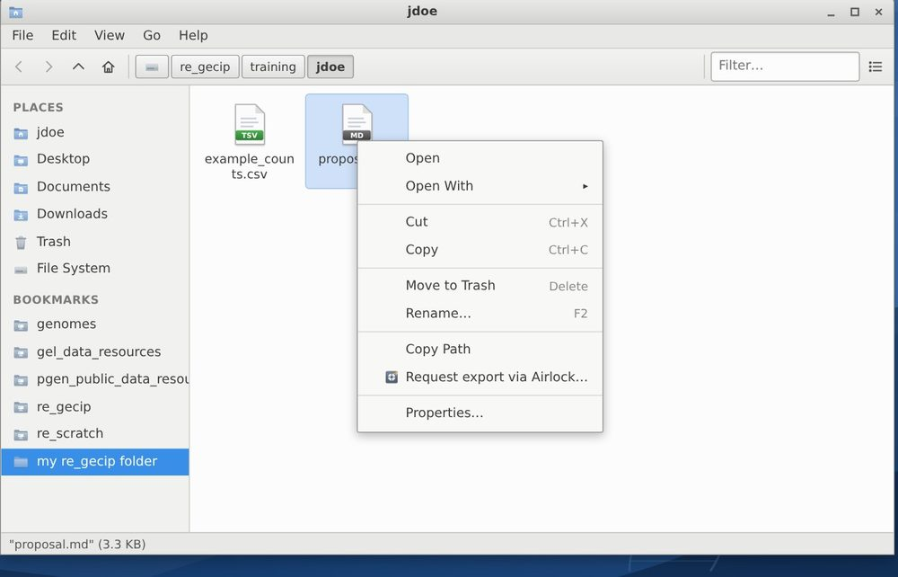
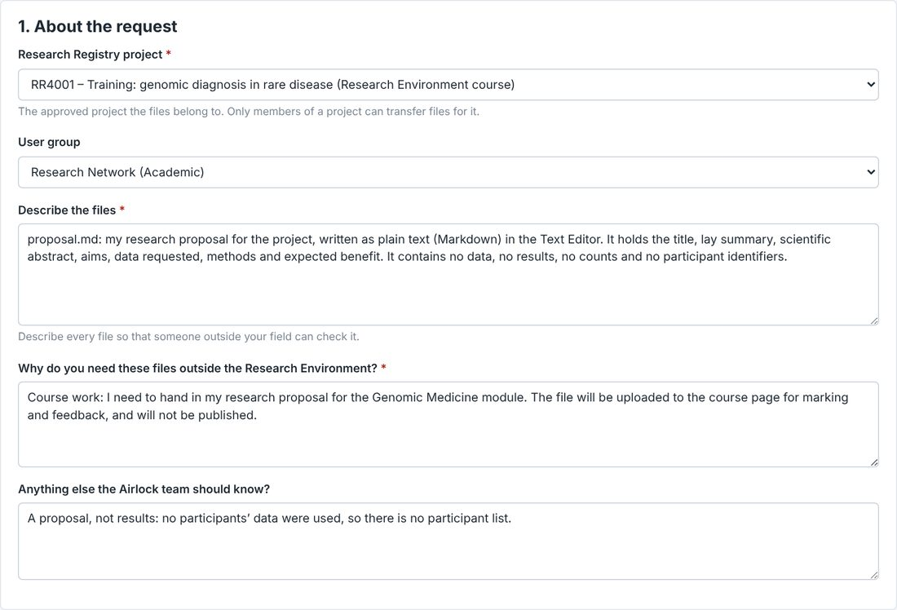
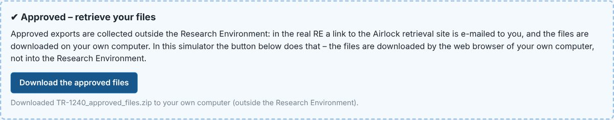
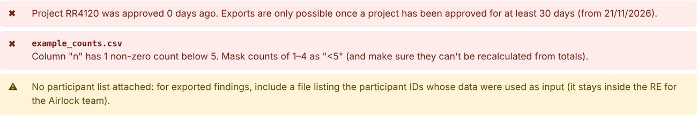
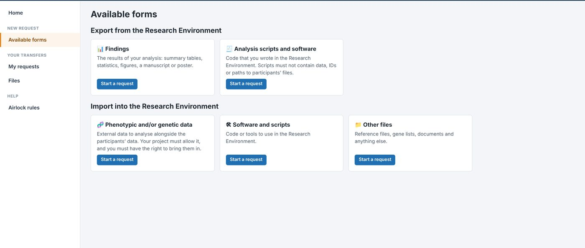

# The Airlock

[Back to the guide](../README.md)

The Airlock is the only way files leave the Research Environment, and the way files come in. Every request names an approved project, is checked against the rules, and is reviewed by the Airlock team (simulated here) before anything moves.

## What may leave

These rules summarise the RE’s; the full versions are in the RE documentation (<https://re-docs.genomicsengland.co.uk/airlock_rules/>), and the simulator has a summary under **Airlock ▸ Airlock rules**.

**Before you start**

- Every transfer belongs to an approved project that you are a member of.
- Exports are only possible once the project has been **approved for at least 30 days**.
- Describe every file so that someone outside your field can check it, and say why you need it outside the RE.

**Not allowed out**

- Participant, sample, family or plate key IDs, or paths to participants’ files.
- Raw sequencing data (BAM, CRAM, FASTQ …), and files the Airlock team cannot read: R objects (`.rds`, `.RData`), databases, other binary files.
- Trained machine-learning models: they can memorise the data they were trained on.
- Screenshots of the RE (IGV views without IDs are the exception).
- Individual-level data (one row per participant, case descriptions), except in rare cases with a strong justification, reviewed by the Airlock Committee.

**Small numbers**

- A count of 1 to 4 participants must not be shown: write `<5`.
- No total or percentage may let someone work out a masked count: mask a second cell, or leave the total out.
- Ages in ranges (10-year ranges are recommended); no dates of birth, death or diagnosis.
- Check figures by eye: no group of fewer than 5 participants, and no IDs.

**Variants**

- Lists of a few hundred variants at most, chosen for their significance, with summary statistics only.
- Larger lists need a justification, and rare variants (low allele counts or frequencies) must not be listed individually.

## Exporting a file, step by step

1. **Put the file in your project folder**, `/re_gecip/training/<you>`. Export final results only: one request per set of results.
2. **Start the request.** In the file manager, right-click the file and choose **Request export via Airlock…**. Or open the **Airlock**, choose **Available forms**, then **Findings** (results, figures, a manuscript or poster) or **Analysis scripts and software** (code you wrote).

    

3. **About the request.** Choose the **Research Registry project** (only approved projects can be chosen) and your user group. **Describe the files**: what is in each one, with acronyms spelled out. Say **why you need them outside the RE**. Use the last box for anything else the Airlock team should know.

    

4. **Files.** Check the list of files, and add any others with **＋ Add files from the Research Environment**. For findings, the form asks for a **participant list**: a file inside the RE listing the participants whose data went into the results. It stays inside the RE, for the Airlock team to check against.
5. **Run the automated check.** It reads your files and the form against the rules, and lists what it finds (✖ a problem that will get the request rejected, ⚠ something to justify or check, ✔ fine).
6. **Tick the declarations** and **Submit request**.
7. **Wait for the review.** In the simulator it takes about 20 seconds: submitted, in review, then approved or rejected. Requests with individual-level data or bulk variant lists go to the Airlock Committee as well.
8. **Download.** Open the approved request (**My requests**) and press **Download the approved files**. A zip file, with your files and a README, downloads to your own computer. In the real RE, a link to the Airlock retrieval site is e-mailed to you instead.

    

## The automated check

| What it says | What to do |
| --- | --- |
| Project … was approved N days ago. Exports are only possible once a project has been approved for at least 30 days | Your project is too new. On this course, use the training project **RR4001** until yours is 30 days old |
| No Research Registry (RR) number / not a project you are a member of / has not been approved yet | Choose an approved project you belong to |
| Column “n” has non-zero counts below 5 | Write counts of 1 to 4 as `<5`, and check that no total gives them away |
| Mentions a count below 5 (for example “n = 3”, “4 participants”) | The text of your files and of the form is checked too: write `<5` |
| Contains Genomics England identifiers | Remove participant, sample, family and plate key IDs |
| Column … gives exact ages or birth years / contains dates about individuals | Use age bands; remove the dates |
| This table looks like individual-level data | Export summaries instead, or give a strong justification |
| Raw sequencing or genotype data / R objects / binary files | Export your results as text, tables, PDF or images instead |
| HTML files should be converted to PDF | Convert, then export the PDF |
| The description (or justification) is very short | Describe every file for a non-specialist, and say how you will use it |
| No participant list attached | Needed for exported results. For a document that uses no participants’ data, such as a proposal, say so in the comments |

The check is only a first pass: the Airlock team still reviews every file by hand. If a request is rejected, the reasons are on its page, with a button to start a new request with the same files.

## Bringing files in

You cannot paste or drag files into the RE. To bring a file in, such as a reference list, a script or a document you wrote on your own computer, use an **import** form (**Airlock ▸ Available forms**): **Phenotypic and/or genetic data**, **Software and scripts**, or **Other files**. Choose the project, describe the files, say why the project needs them (and, for data, whether you are allowed to bring them in), and upload them from your computer. Once the import is approved, the files are under **Airlock ▸ Files**, in a folder named after the request: **Save all to my folder** copies them into your folders.

## Next

- [Week 1: register a project, and hand in your approved proposal](../tasks/week-01-pre-registration.md)
