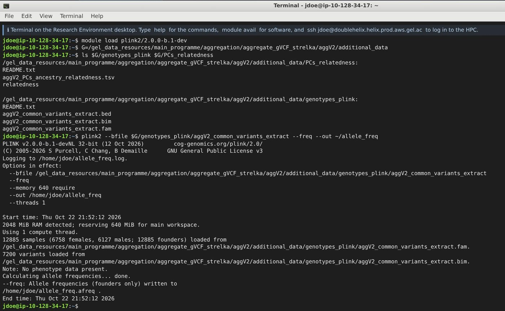
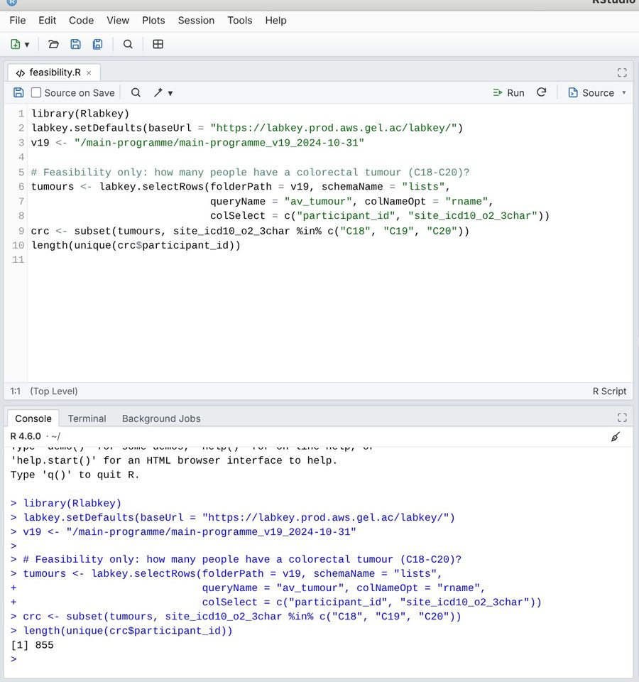
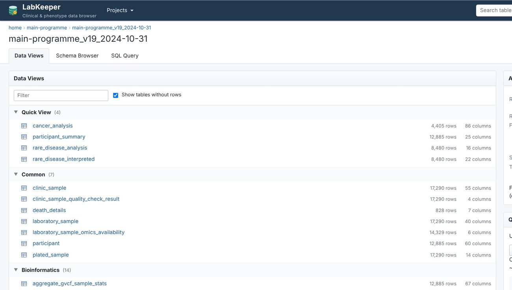

# The applications

[Back to the guide](../README.md)

The icons on the left of the desktop open these applications. They are also in the **Applications** menu at the top left.

| | Application | Use it to |
| --- | --- | --- |
|  | [Terminal](#terminal) | Run command-line programs (PLINK 2, samtools …), load modules, submit jobs to the HPC |
|  | [Home](#home-the-file-manager) | Manage your files; start an Airlock export |
|  | [RStudio](#rstudio) | Analyse data in R; read LabKeeper’s tables with Rlabkey |
|  | [Spyder](#spyder) | Analyse data in Python; read LabKeeper’s tables with labkey |
|  | [Text Editor](#text-editor) | Write scripts, notes and your project proposal |
|  | [LabKeeper](#labkeeper) | Browse, filter and export the clinical tables of each data release |
|  | [IGV](#igv) | Look at reads and variants in BAM, CRAM and VCF files |
|  | [Variant Interpreter](#variant-interpreter) | Classify a variant with the ACMG/AMP criteria |
|  | [Research Registry](#research-registry) | Register a project and follow its review |
|  | [Airlock](#airlock) | Take files out of the RE, or bring files in, after review |
|  | [Web Browser](#web-browser) | Reach the RE’s websites and a short whitelist of reference sites |
|  | [RE Documentation](#re-documentation) | A start page with a route through the RE |

## Terminal

A bash shell with real command-line programs, compiled to run in your browser: PLINK 2, SAMtools, BCFtools (with its plugins), HTSlib’s bgzip and tabix, bedtools, mosdepth, minimap2, BWA, Bowtie 2, HISAT2, fastp, Cutadapt, FreeBayes, Strelka2, ExpansionHunter, featureCounts, Salmon, kallisto and others, plus the usual text tools (`grep`, `sed`, `awk`, `sort` …), Snakemake, `python3` and `R`/`Rscript`.

- **Type `help`** for the RE’s own commands, and `man <program>` for a program’s manual.
- **Programs are environment modules**, as in the RE. `module avail` lists them, and a program is “command not found” until you load it:

    ```bash
    module avail
    module load plink2/2.0.0-b.1-dev
    module load samtools/1.21
    ```

    SAMtools, BCFtools and HTSlib come in two versions, 1.16 and 1.21, as on the RE. Scripts, Snakemake and HPC jobs inherit the modules you have loaded.
- **The HPC.** Larger jobs run on the (simulated) high-performance cluster, with the LSF scheduler. See [A closed environment](closed-environment.md#the-hpc).



## Home (the file manager)

Your files. The left-hand side lists your places and bookmarks, including **my re_gecip folder**, which is your project folder, `/re_gecip/training/<your username>`. Right-click a file for **Open With**, **Copy Path**, **Rename**, **Properties** and **Request export via Airlock…**. You cannot drag files in from your own computer: files come in through the Airlock (see [The Airlock](airlock.md#bringing-files-in)).

## RStudio

RStudio with R 4.6: the Source editor, Console, Environment, History, Files, Plots, Packages, Help and Viewer panes, and a Terminal tab. R Markdown documents knit as usual.

- `library(Rlabkey)` reads LabKeeper’s tables, as in the RE. Set up your `~/.netrc` file first: see [The data](data.md#from-r).
- `install.packages()` works for packages that have been built for R in the browser; not every CRAN package has. In the real RE, packages come from an internal mirror instead.
- R starts the first time you open RStudio, which takes a little while. Closing RStudio ends its R session: objects in memory are lost, but your files are kept.



## Spyder

Spyder with Python 3.13: the Editor, IPython console, Variable Explorer, Plots and Files. NumPy, pandas and Matplotlib are ready to use. `import labkey` reads LabKeeper’s tables, as in the RE: see [The data](data.md#from-python).

## Text Editor

A plain-text editor (Mousepad) with tabs, search and replace, and syntax colouring. **View ▸ Word Wrap** wraps long lines, and **View ▸ Zoom In** makes the text bigger. Use it for notes, scripts and your project proposal: copy and paste work between it and the other applications.

## LabKeeper

The data browser for the clinical tables, a copy of LabKey Server as the RE uses it. Sign in with your RE username (any password).

- **Projects**: `main-programme` (the 100,000 Genomes Project) and `nhs-gms` (the NHS Genomic Medicine Service). Open a project, then its data release.
- **Data Views** lists the tables by category, with their numbers of rows and columns.
- **A table opens as a grid**: sort and filter by column, page through, choose columns, save a view, draw a quick chart.
- **Export**: Excel, TSV or CSV (saved in `~/Downloads`, inside the RE), or **Script**, which writes the R or Python code that fetches exactly the rows you are looking at. That is the easiest way to move from browsing to a reproducible script.
- **Schema Browser** lists every column of every table; **SQL Query** runs LabKey SQL.



More about the tables in [The data](data.md).

## IGV

IGV desktop, for looking at sequence reads and variants. **File ▸ Load from File…** opens BAM, CRAM, VCF, BED and GFF files. To find a participant’s files, look up their paths in the `genome_file_paths_and_types` table rather than browsing `/genomes`. In the simulator, only the example genomes (the HCC1395 tumour and normal cell lines) have real files behind their paths.

## Variant Interpreter

A website of the RE for interpreting a variant: you gather the evidence and apply the ACMG/AMP criteria to classify it.

## Research Registry

Where every project is registered before any analysis, and where you follow its review. See [The Research Registry](research-registry.md).

## Airlock

The only way files leave the RE (or come in). See [The Airlock](airlock.md).

## Web Browser

The browser in which LabKeeper, the Registry, the Airlock and the Variant Interpreter open, with tabs, an address bar, bookmarks and history. Other websites are blocked, as in the RE, except a short whitelist of reference sites (PanelApp, ClinVar, gnomAD, Ensembl, PubMed, the RE documentation and others): these open in a tab of your own browser, because they cannot be shown inside another page. The **Whitelisted sites** bookmark lists them.

## RE Documentation

The RE’s start page: links to the web tools, a getting-started route (find a cohort, find the files, analyse, look at the reads, take results out), the common terminal commands, and the whitelist.

## Settings Manager

In the Applications menu, under System. It has the desktop’s settings and the instructors’ **Training controls**, which change how the simulated reviews behave in your browser. Leave the training controls alone unless your course team asks you to change them.
