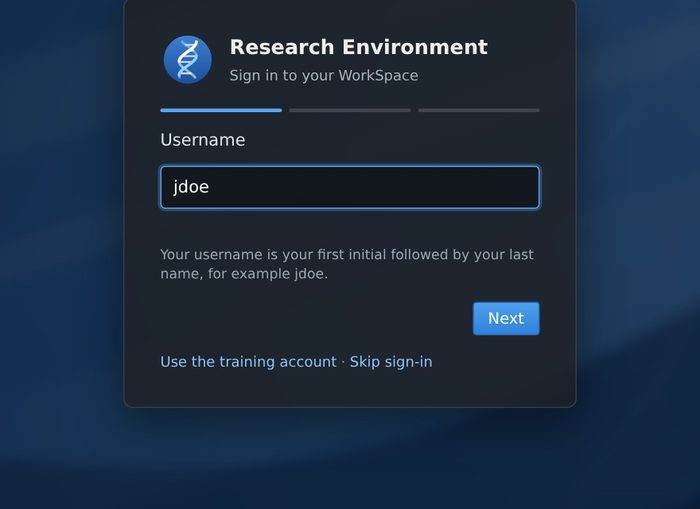

# Getting started

[Back to the guide](../README.md)

## What you need

- A laptop or desktop computer with about 8 GB of memory. It works on a phone, but cramped.
- A current version of Chrome, Edge, Firefox or Safari.
- An internet connection. R and Python are downloaded the first time you use them (some tens of megabytes each), and your browser keeps them after that.

## Opening the simulator

Go to <https://comparativechrono.github.io/GEL-environment/>.

The first time you open it, the page reloads itself once. That is expected: it is installing a small helper that R and Python need.

## Signing in

The sign-in screens stand for the remote-desktop client you would use for the real RE. There are three:

1. **Username**: your first initial followed by your surname, in lower case, for example `jdoe` for Jane Doe.
2. **Password**: any password is accepted.
3. **Verification code**: any six digits are accepted.

Use the same username every time. Each username has its own files, projects and Airlock requests, so if you sign in as someone else you will not see your work.

## The desktop

The desktop is an Xubuntu desktop, like an RE WorkSpace:

- **The panel** at the top has the **Applications** menu, a button for each open window, the clock, notifications and your user menu.
- **The icons** on the left open the applications. Double-click to open one. [The applications](applications.md) describes them all.
- **Windows** move, resize, maximise and minimise as on any desktop. Double-click a title bar to maximise a window.
- **Notifications** appear at the top right, for example when your project is approved or an Airlock request has been reviewed. Click one to open the record it is about.

Files open in the right application when you double-click them in the file manager, or use **Open With** from the right-click menu. From the terminal, `xdg-open file`, `mousepad notes.txt`, `rstudio script.R` and `igv file.bam` do the same.

## Where your work is kept

Everything you do in the simulator is kept **by your web browser, for this website**: your files, settings, projects and Airlock requests. There is no server copy. This means:

- Use the **same browser on the same computer** each time. Another browser, or another computer, starts empty.
- **Don’t use a private or incognito window.** It keeps nothing once you close it.
- **Don’t clear this site’s data** in your browser settings.
- The only way to take a copy of something out is the **Airlock**, as in the real RE: export anything you need to keep or hand in. The one exception is the copy of an approved proposal that the **Research Registry** downloads to your computer (see [Week 1](../tasks/week-01-pre-registration.md)).

## Starting again

Adding `?reset` to the address, <https://comparativechrono.github.io/GEL-environment/?reset>, **deletes everything** the simulator keeps in your browser: files, projects and requests. Only do this if your course team asks you to, or if the simulator is broken and nothing else works.

## Useful addresses

| Address | What it does |
| --- | --- |
| `…/GEL-environment/?user=jdoe` | Signs in as `jdoe` without the sign-in screens |
| `…/GEL-environment/?fast` | Skips the “reconnecting to your WorkSpace” screen |
| `…/GEL-environment/?open=research-registry,airlock` | Opens applications after sign-in. Their names: `terminal`, `file-manager`, `rstudio`, `spyder`, `text-editor`, `labkeeper`, `variant-interpreter`, `igv`, `airlock`, `research-registry`, `web-browser`, `documentation`, `settings` |

You can combine them, for example `?user=jdoe&fast&open=research-registry`.

## Next

- [The applications](applications.md)
- [The data](data.md)
- [A closed environment](closed-environment.md)
