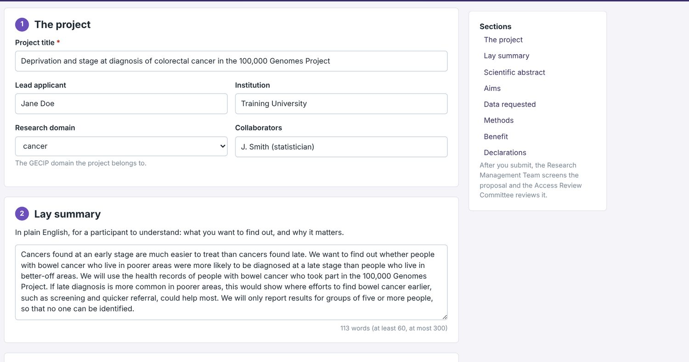
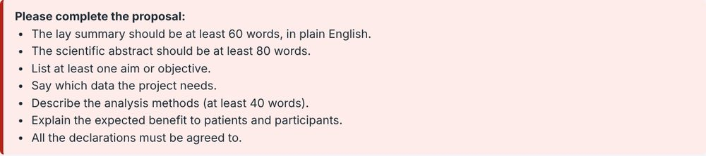
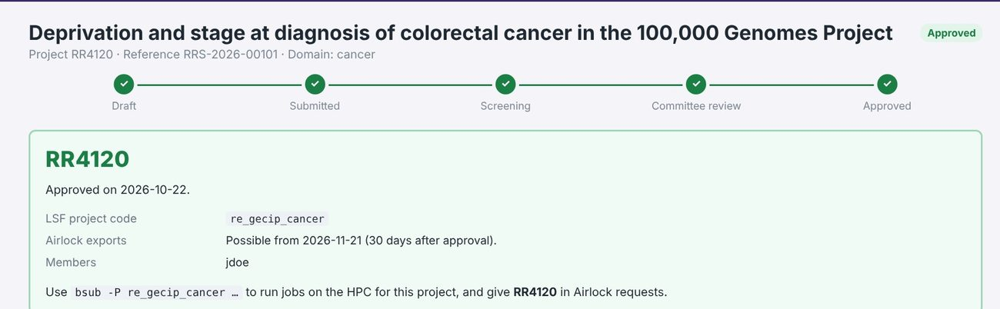

# The Research Registry

[Back to the guide](../README.md)

In the RE, every analysis belongs to a registered, approved project, and every file that leaves through the Airlock names that project. You register a project in the **Research Registry**. On this course your proposal is also your **pre-registration**: a dated plan of what you will do, written before you see the results.

## How a proposal is reviewed

1. **Draft.** You write the proposal. It is saved as you type, so you can come back to it.
2. **Screening.** A check that the proposal is complete and in scope.
3. **Committee review.** Is the project in the participants’ interest, and does it ask only for the data it needs? The committee may ask for revisions.
4. **Approval.** The project gets a **Research Registry number** (an RR number, such as RR4120) and an **LSF project code** for the HPC.
5. **30 days after approval**, results can be exported through the Airlock, citing the RR number.

In the simulator the review takes about 20 seconds (your course may decide proposals by hand instead), and **How review works** in the Registry describes it. It is a simplified version of the real process: at Genomics England, academic projects are reviewed by the Research Management team, and the Access Review Committee reviews commercial ones. The 30-day rule is real.

Every user of the simulator is also a member of an approved training project, **RR4001**, which you can use for Airlock exports straight away.

## Starting a proposal

Open **Research Registry** from the desktop and choose **New proposal**. The form has eight sections; the list on the right jumps between them, and the word count under each box tells you what it needs.



The examples below come from a worked example, *Deprivation and stage at diagnosis of colorectal cancer in the 100,000 Genomes Project*. It is not one of the suggested topics.

## The form, section by section

For each section: what the form asks for, and the statistical questions to answer as you write it.

### 1. The project

**The form asks for** a descriptive title (required), the lead applicant and institution, the research domain (a GECIP domain, which sets your project’s folder and HPC code) and collaborators (who must have RE accounts).

**Statistics.**

- Does the title name the **outcome**, the **exposure** and the **population**? *Deprivation (exposure) and stage at diagnosis (outcome) of colorectal cancer in the 100,000 Genomes Project (population).*
- Who will check your statistics? Bring a statistician in now, at the design stage.

### 2. Lay summary

**The form asks for** 60 to 300 words of plain English, for a participant to understand: what you want to find out, and why it matters. In the real Research Registry the title and lay summary of every approved project are published.

**Statistics.**

- Can you say **what you will compare** without jargon? Not “we will estimate an odds ratio”, but “we want to find out whether people in poorer areas are more often diagnosed at a late stage”.
- Say that small groups will not be reported, so that no one can be identified.

### 3. Scientific abstract

**The form asks for** at least 80 words: background, aims, data and methods, expected results.

**Statistics.**

- State the **hypothesis** you will test, in a form that data could contradict.
- Name the **primary outcome**, the **exposure**, the **population** and the **main analysis**.
- Say what **estimate** you will report, with its uncertainty: for example an odds ratio with its 95% confidence interval.
- “Expected results” is not a prediction that p < 0.05. Commit to reporting the estimate, whatever its size or direction.

### 4. Aims and objectives

**The form asks for** a list of aims (**＋ Add an aim** adds another).

**Statistics.**

- One question per aim, each answered by one analysis.
- Label **one aim primary** (confirmatory) and the others **secondary** or **exploratory**.
- Every aim adds tests, and with them chances of a false positive: you will meet multiple testing in week 5.
- An exploratory finding can be reported, but as exploratory: it cannot become the primary aim afterwards.

### 5. Data requested

**The form asks for** the kinds of data you need, as tick boxes, with a reminder to request only what the project needs (data minimisation).

**Statistics.**

- Everything the analysis needs: the **outcome**, the **exposure**, the variables that **define your cohort**, and the **confounders** you will adjust for (week 4).
- But no more: data you have no plan for don’t belong in the request.
- Check feasibility: count the people who meet your criteria in LabKeeper. **Don’t look at the outcome by the exposure** before you register, or the plan is no longer made before you saw the results. Say in the methods what you have already looked at.

### 6. Methods

**The form asks for** at least 40 words: “Cohort definition, analyses, tools, how you will handle small numbers.” Forty words is far too few for a real plan: this section is what makes the proposal a pre-registration.

**Statistics.** Cover each of these:

| | Questions to answer |
| --- | --- |
| **Cohort** | Who is in, and who is out? Which table and column define it? One record per person? |
| **Variables** | The outcome, the exposure and the covariates: which tables and columns, and how will you code them (for example, which stages count as “late”)? What kind of variable is each: binary, categorical, ordinal, count, continuous? |
| **Analysis** | Which test or model, and which estimate will you report? Which variables will you adjust for, and why? |
| **Sample size** | How many people are eligible, and what size of effect can that number detect? |
| **Missing data** | What will you do with people whose outcome or exposure is missing? |
| **Multiple testing** | How many tests will you run, and how will you allow for them? |
| **Small numbers** | Which groups might have fewer than 5 people, and how will you merge categories or bands so that you can report them? |
| **Software** | Which software, with versions, and where will your script be kept? |

The kind of outcome largely decides the method: a binary outcome (diagnosed or not) suggests a comparison of proportions or logistic regression; a continuous one (body mass index) a t-test, ANOVA or linear regression; a count (de novo mutations) a Poisson-type model; a genotype, an association test or a GWAS; a time to an event, survival analysis. You will learn these over the coming weeks. For now, name the kind of outcome and what you want to compare or adjust for.

For the sample size, R has `power.prop.test()` and `power.t.test()`, and you can simulate (week 2). For example, telling a 40% rate from a 50% rate with 80% power at the 5% level needs about 390 people in each group:

```r
power.prop.test(p1 = 0.40, p2 = 0.50, power = 0.80)
```

### 7. Benefit to patients and participants

**The form asks for** at least 20 words: who would gain from the answer, and how.

**Statistics.**

- What size of difference would matter to patients? That is the effect your study needs the power to detect.

### 8. Declarations

**The form asks** you to agree that you have done the training and will follow the rules; that the data will only be analysed inside the RE, and only results approved through the Airlock will leave it; that you will not try to identify or contact any participant; and that you will follow the publication policy (results are shared with Genomics England before they are published).

**Statistics.**

- The Airlock’s small-numbers rule decides what you can report: plan your tables so that every group has at least 5 people.

## Submitting

**Submit for review** checks that the proposal is complete: the word counts, at least one aim, the data, and all four declarations. It does not check the science.



Once it is submitted, your project page shows its progress: submitted, screening, committee review, approved. When it is approved you get your RR number, your LSF project code, and the date from which Airlock exports are possible.



## Make it a pre-registration

A Research Registry proposal is an access application, and its form only checks word counts, so a vague methods section will get through. You make it a pre-registration by what you write:

- Put the **whole analysis plan** in the methods, specific enough that someone could check later whether you followed it.
- Say **what you have already looked at** (for example, your feasibility counts).
- **Keep a dated copy**: export your proposal through the Airlock (see [Week 1](../tasks/week-01-pre-registration.md)).
- When you report the work, report **any changes to the plan, and why** you made them. Keep a log as you go.

In a real project you would also register the plan publicly, for example on [OSF Registries](https://osf.io/registries), which has a template for analyses of existing data (van den Akker et al. 2021, *Meta-Psychology* 5).

## Next

- [The Airlock](airlock.md)
- [Week 1: register a project and export your proposal](../tasks/week-01-pre-registration.md)
