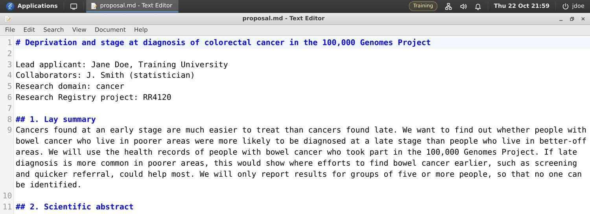
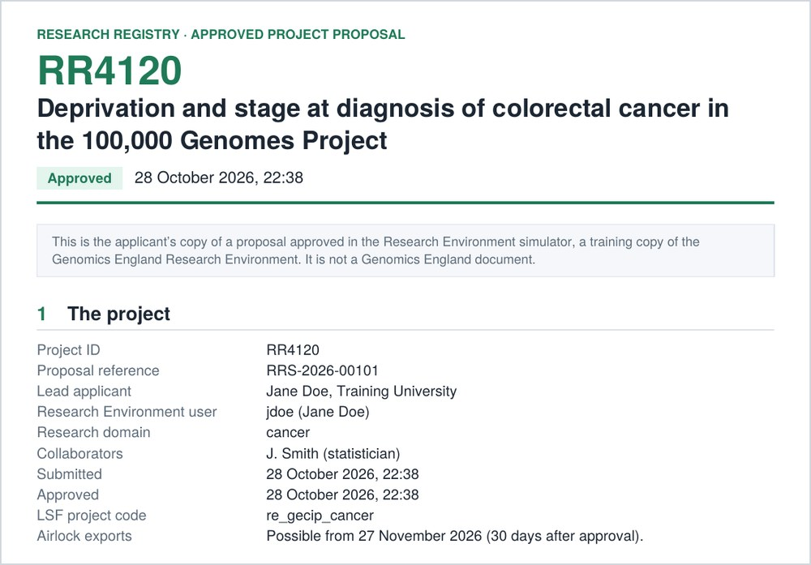

# Week 1: register a project, and hand in your approved proposal

[All tasks](README.md) · [Back to the guide](../README.md)

This week you plan a study on the simulator’s data and register it in the Research Registry. When the project is approved, the Registry downloads a copy of your approved proposal, a PDF, to your own computer: that copy is what you hand in. Your registered proposal is your **pre-registration**: a dated plan, written before you see any results. We don’t expect a perfect plan. It is a first one, and you will revise it as you learn the methods over the coming weeks.

**Time:** about two hours.\
**You will use:** LabKeeper, the Text Editor, the Research Registry.\
**You will hand in:** the PDF of your approved proposal, which the Registry downloads to your computer.

## Steps

1. **Open the simulator** at <https://comparativechrono.github.io/GEL-environment/> and sign in with your first initial and surname (for example `jdoe`). Use the same username every time. See [Getting started](../docs/getting-started.md).

2. **Choose a question.** Pick one from the list below, or bring your own idea: most ideas fit one of these.

3. **Explore its tables in LabKeeper.** Open the tables, read their columns in the **Schema Browser**, and work out how they join (usually on `participant_id`). Count the people who meet your criteria, so that you know what is feasible. **Don’t look at your outcome by your exposure**: once you have, your plan is no longer made before you saw the results. See [The data](../docs/data.md).

4. **Write your proposal in the Text Editor.** You can’t paste in from your own computer, so write it in the RE. Use the skeleton below, and save it as `proposal.md` in your project folder, `/re_gecip/training/<your username>`. For each section, [The Research Registry](../docs/research-registry.md#the-form-section-by-section) lists the statistical questions to answer.

    

5. **Register it.** Open the **Research Registry**, choose **New proposal**, and copy each section of your file into the form (copy and paste work inside the RE). Tick the declarations and **Submit for review**. When it is approved (about 20 seconds), note your **RR number** and add it to `proposal.md`.

6. **Find your copy, and hand it in.** When the project is approved, your web browser downloads a copy of the approved proposal to your own computer, wherever it saves downloads (usually your Downloads folder). It is a PDF named after your RR number and username, such as `RR4120_jdoe_approved_proposal.pdf`. It is the only thing that reaches your computer without going through the Airlock, so you don’t export anything this week. Open it, and check that it has your RR number, the date of approval and every section as you submitted it. Hand it in as your course team asks.

    

    If the copy didn’t download, or you have lost it, open your project in the Registry (**My projects**): the button beside **Your copy** downloads it again.

## Questions you could ask

★ marks a good first project: one or two tables, and a test from weeks 2 and 3. The others need joins, regression or genome-wide methods that come later in the course, which is fine: you are writing a plan, and you will revise it.

### Rare disease

| | Question | Tables to start from |
| --- | --- | --- |
| | What predicts a genetic diagnosis? | `gmc_exit_questionnaire`, `participant`, `rare_diseases_family`, `rare_diseases_participant_disease`, `rare_diseases_participant_phenotype` |
| | Does the diagnostic yield differ between Genomic Medicine Centres? | `gmc_exit_questionnaire`, `participant` |
| ★ | Do older fathers pass on more de novo mutations? | `denovo_cohort_information`, `participant` |
| ★ | Does the gene change the disease? PKD1 or PKD2 in cystic kidney disease; GCK or HNF1A in monogenic diabetes; MYBPC3 or MYH7 in cardiomyopathy | `gmc_exit_questionnaire`, `rare_diseases_imaging`, `rare_diseases_invest_blood_laboratory_test_report` |
| | Can we find new disease genes? | `tiering_data`, `rare_diseases_participant_disease` |
| | Is a common variant associated with seizures? | `rare_diseases_participant_phenotype`, the genotype files |
| | Does ancestry change the number of candidate variants? | `tiering_data`, `participant_summary` |
| | Is any de novo variant recurrent? | `denovo_flagged_variants` |

### Cancer

| | Question | Tables to start from |
| --- | --- | --- |
| ★ | How does tumour mutational burden vary, and does sample preparation matter? | `cancer_analysis` |
| ★ | Which driver genes are mutated, how often, and which never together? | `cancer_tier_and_domain_variants`, `cancer_analysis` |
| ★ | Are germline BRCA1/2 carriers diagnosed younger, and is their tumour’s mutational signature different? | `cancer_tier_and_domain_variants`, `cancer_analysis`, `participant_summary` |
| ★ | Do the cancer registry and the clinical record agree on stage? | `cancer_participant_tumour`, `cancer_staging_consolidated`, `av_tumour` |
| | Smoking, CHRNA5 and lung cancer | `cancer_risk_factor_general`, `cancer_analysis`, the genotype files |
| | What predicts survival after cancer? | `participant_summary`, `mortality`, `cancer_staging_consolidated`, `av_rtd` |

### Common disease and data quality

| | Question | Tables to start from |
| --- | --- | --- |
| ★ | Body mass index and FTO | `cancer_risk_factor_general`, `rare_diseases_gen_measurement`, the genotype files |
| | Do polygenic scores work in every ancestry? | `genomicsplc_prs_values`, `participant_summary`, `hes_apc` |
| | Who was admitted to hospital with COVID-19? | `covid_test_results`, `hes_apc`, `participant_summary`, the genotype files |
| | APOL1 and kidney disease in people of African ancestry | The genotype files and principal components, `hes_apc` |
| | A genome-wide association study of a hospital diagnosis | `hes_apc`, the genotype files and principal components |
| | A genotype quality-control audit | The genotype files, `aggregate_gvcf_sample_stats`, `sequencing_report`, the relatedness files |
| | Does a finding replicate in the NHS GMS release? | The NHS GMS release’s tables and genotype files |

The genotype files, principal components and relatedness files are described in [The data](../docs/data.md#the-genotype-files).

## A skeleton for your proposal

Type this into the Text Editor and fill it in. The headings match the Registry’s sections.

```markdown
# Title: the outcome, the exposure and the population

Lead applicant: your name, your institution
Research domain: the GECIP domain
Research Registry project: your RR number, once approved

## 1. Lay summary
60 to 300 words of plain English: what you want to find out, and why it matters.

## 2. Scientific abstract
At least 80 words. Background. Aim: the hypothesis you will test. Data and methods:
the population, the outcome, the exposure, the main analysis and the estimate you will
report. Expected results: what you will report, whatever it shows.

## 3. Aims and objectives
1. Primary:
2. Secondary:
3. Exploratory:

## 4. Data requested
The kinds of data, and the tables you will use.

## 5. Methods
Cohort: who is in, who is out, and from which tables.
Outcome: which column, and how you will code it.
Exposure: which column, and how you will code it.
Covariates: what you will adjust for, and why.
Analysis: the test or model, and the estimate you will report.
Sample size: how many are eligible, and what size of effect that can detect.
Missing data: what you will do about it.
Multiple testing: how many tests, and how you will allow for them.
Small numbers: how you will group categories so that no group is below 5.
Software: R or Python, with versions; where the script will be kept.
Already looked at: the feasibility counts you have made.

## 6. Benefit to patients and participants
At least 20 words: who would gain from the answer, and how.
```

## Before you submit

- [ ] One primary question, stated as a hypothesis
- [ ] The cohort: who is in, and who is out
- [ ] The outcome and the exposure: which table and column each comes from
- [ ] The confounders you will adjust for
- [ ] The test or model, and the estimate you will report
- [ ] How many people you have, and what that lets you detect
- [ ] What you will do about missing data, multiple testing and small numbers
- [ ] The software, with versions
- [ ] No IDs, and no counts below 5, anywhere in the text (your copy of it leaves the RE)
- [ ] Saved as `proposal.md` in your project folder

## Keep a log

From now on, keep a file called `changes.md` next to your proposal. Every time you change your plan, add a line with the date, what changed and why. When you report your project, this log is what lets a reader see what was planned and what wasn’t.
